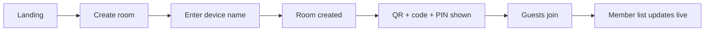
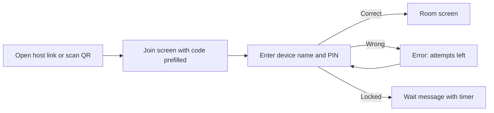
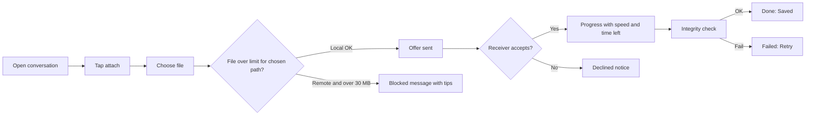
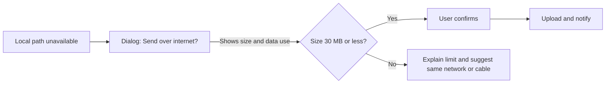

# LocalLink: UI/UX Flows and Wireframes

| Field | Value |
|---|---|
| Document | 08 of 11, UI/UX Flows and Wireframes |
| Version | 1.0 (draft for review) |
| Tools to use next | Figma (high-fidelity), this document as the low-fidelity spec |
| Related | 01-PRD (user stories), 02-SRS, 03-Transfer-Mode-Strategy, 09-Cable-Setup-Guide |

---

## 1. Design Principles

1. **Zero learning curve:** a first-time guest should join and send in under 30 seconds.
2. **Always show the path:** `Direct`, `Via host`, `Internet`. Users should know where their data goes.
3. **No jargon:** say "Nearby devices", not "peers".
4. **Mobile first:** most guests join from phones (360 px wide); desktop gets more space, not more features.
5. **Calm, trustworthy look:** blue (LocalLink brand) with green for success and orange for warnings; lots of whitespace.
6. **Errors tell people what to do next.**
7. **Accessible:** WCAG 2.1 AA, keyboard navigable, screen-reader labels, not relying on colour alone.

## 2. Visual Style Guide (starting point)

| Item | Value |
|---|---|
| Primary colour | `#1E6BE0` (blue), dark `#0F3F94` |
| Accent | `#16A34A` (success green), `#F59E0B` (warning), `#DC2626` (error) |
| Neutral | Text `#111827`, muted `#6B7280`, border `#E5E7EB`, background `#F8FAFC` |
| Dark theme | Background `#0B1220`, surface `#111A2E`, text `#E5E7EB` |
| Font | System font stack (offline, no web fonts): `system-ui, -apple-system, "Segoe UI", Roboto, sans-serif` |
| Base size | 16 px; headings 24/20/18 px |
| Radius | 12 px cards, 999 px chips |
| Spacing scale | 4, 8, 12, 16, 24, 32 |
| Touch target | At least 44 × 44 px |
| Breakpoints | Mobile < 640 px, tablet 640-1024 px, desktop > 1024 px |
| Icons | Inline SVG set (for example Lucide, bundled locally) |
| Motion | 150-200 ms transitions; respect `prefers-reduced-motion` |

## 3. Site Map and Routes

```
/                      Landing (Create room / Join room)
/create                Create room
/join                  Join room (code + PIN, or scan)
/join?room=ANIL-4821   Join with prefilled code (from QR)
/room/:code            Room (member list + conversations)
/room/:code/chat/:id   Conversation with a person or "Everyone" (mobile deep view)
/cable                 Faster with cable guide
/help                  Help (offline join, certificate trust, safety code, privacy)
/settings              Settings
*                      Not found
```

## 4. Key User Flows

### 4.1 Host: create a room



### 4.2 Guest: join a room



### 4.3 Send a file



### 4.4 Remote fallback



## 5. Screen Specifications and Wireframes

Wireframes use ASCII for quick review. `[ ]` = button or input, `( )` = radio or toggle.

### 5.1 Landing (`/`)

```
┌──────────────────────────────────────────┐
│  🔗 LocalLink                       ⚙ ?  │
│  Chat and share files with nearby        │
│  devices. No internet needed.            │
│                                          │
│  ┌────────────────────────────────────┐  │
│  │  [  Create a room            ]     │  │
│  └────────────────────────────────────┘  │
│  ┌────────────────────────────────────┐  │
│  │  [  Join a room              ]     │  │
│  └────────────────────────────────────┘  │
│                                          │
│  ✓ End-to-end encrypted                  │
│  ✓ Works on any device with a browser    │
│  ⚡ Faster with a cable  →                │
└──────────────────────────────────────────┘
```
Elements: two primary buttons, trust bullets, link to Cable guide, footer with Help and Privacy. If the page is not served over HTTPS or Web Crypto is missing, show a blocking banner: "This connection isn't secure enough. Open the HTTPS link shown on the host device." with a link to Help.

### 5.2 Create Room (`/create`)

```
┌──────────────────────────────────────────┐
│  ←  Create a room                        │
│                                          │
│  Your device name                        │
│  [ Anil's Laptop                     ]   │
│                                          │
│  Room lasts                              │
│  ( ) 1 hour (•) 4 hours ( ) 8 hours      │
│                                          │
│  Max devices      [ 8  ▾ ]               │
│  [ ] Quick join (QR includes the PIN)    │
│                                          │
│  [        Create room        ]           │
└──────────────────────────────────────────┘
```
Validation: name 1-32 characters. Errors inline under the field.

### 5.3 Room Lobby / Share (host view, shown after create and from the room header "Invite")

```
┌──────────────────────────────────────────┐
│  Room ANIL-4821               ⏱ 3h 58m   │
│                                          │
│   ┌──────────────┐   PIN                 │
│   │  ▓▓ QR ▓▓    │   7 3 9 4 2 1         │
│   │  ▓▓▓▓▓▓▓▓    │   [ Rotate PIN ]      │
│   └──────────────┘                       │
│   Network:  (•) Wi-Fi 192.168.1.20       │
│             ( ) Cable 169.254.8.4  ⚡     │
│   https://192.168.1.20:8443/join?room=…  │
│   [ Copy link ]   [ Share ]              │
│                                          │
│  Nearby devices (2)                      │
│   🟢 Anil's Phone     Android            │
│   🟡 Rahul's Tablet   connecting…        │
│                                          │
│  [  Open chat  ]   [ Close room ]        │
└──────────────────────────────────────────┘
```
Notes:
- Choosing the network updates the QR and URL.
- Show a tip when more than one address exists: "Guests must be on the same network as the address you choose."
- PIN visible with a "hide" toggle.

### 5.4 Join (`/join`)

```
┌──────────────────────────────────────────┐
│  ←  Join a room                          │
│                                          │
│  [ 📷 Scan QR code ]                     │
│  ─────────  or  ─────────                │
│  Room code   [ ANIL-4821             ]   │
│  PIN         [ ● ● ● ● ● ●           ]   │
│  Your name   [ Anil's Phone          ]   │
│                                          │
│  [          Join room          ]         │
│  Not working? See help                   │
└──────────────────────────────────────────┘
```
Behaviour: numeric keypad for PIN; auto-submit when 6 digits are typed and name is set; QR scan opens the camera with a framing guide; permission-denied state explains how to allow the camera.

### 5.5 Room screen: Desktop (two-pane)

```
┌────────────────────────────────────────────────────────────────────┐
│ Room ANIL-4821  ·  8 max  ·  ⏱ 3h 40m         [Invite] [⚡Cable] [⚙]│
├───────────────────────┬────────────────────────────────────────────┤
│ Nearby devices        │  Rahul's Tablet     🟢 Direct   🔒 Verified │
│ ┌───────────────────┐ │ ────────────────────────────────────────── │
│ │ 👥 Everyone       │ │   Rahul  10:21                             │
│ ├───────────────────┤ │   Notes for unit 3?                        │
│ │ 🟢 Rahul's Tablet │ │                                            │
│ │ 🟢 Anil's Phone   │ │                      Sure, sending now. ✓✓ │
│ │ 🟠 Meera's PC (r) │ │   ┌────────────────────────────────────┐   │
│ └───────────────────┘ │   │ 📄 unit3-notes.pdf   12.4 MB       │   │
│                       │   │ ███████████░░░░  74%  38 MB/s      │   │
│ (r) = Internet only   │   │ 1 s left        [ Cancel ]         │   │
│                       │   └────────────────────────────────────┘   │
│                       │ ────────────────────────────────────────── │
│                       │ [📎] [ Type a message…            ] [Send] │
└───────────────────────┴────────────────────────────────────────────┘
```

### 5.6 Room screen: Mobile (list then chat)

```
┌─────────────────────────┐      ┌─────────────────────────┐
│ ANIL-4821    ⏱3h40m  ⋮ │      │ ← Rahul's Tablet 🟢Direct│
│                         │      │ 🔒 Verified              │
│ Nearby devices          │      │─────────────────────────│
│ 👥 Everyone             │      │  Notes for unit 3?      │
│ 🟢 Rahul's Tablet       │      │          Sending now ✓✓ │
│ 🟢 Anil's Phone         │      │  📄 unit3-notes.pdf     │
│ 🟠 Meera's PC (Internet)│      │  ███████░░  74%         │
│                         │      │─────────────────────────│
│ [ + Invite ]  [⚡ Cable ]│      │[📎][ Message…      ][➤]│
└─────────────────────────┘      └─────────────────────────┘
```

### 5.7 Send file sheet (attach)

```
┌──────────────────────────────────────────┐
│  Send to Rahul's Tablet                  │
│  Path: 🟢 Direct (local)                 │
│                                          │
│  [ Choose files…  ]  or drop files here  │
│                                          │
│  📄 unit3-notes.pdf       12.4 MB   ✕    │
│  🖼 lab-photo.jpg          3.1 MB   ✕    │
│                                          │
│  Total 15.5 MB · Local limit 2 GB        │
│  [ Cancel ]            [ Send 2 files ]  │
└──────────────────────────────────────────┘
```
For `Internet` path the sheet shows: "Internet limit 30 MB per file. This will use about 15.5 MB of mobile data." and disables Send if any file is over 30 MB with the message "unit3.zip is 41 MB. Over the 30 MB limit."

### 5.8 Incoming file offer (receiver)

```
┌──────────────────────────────────────────┐
│  Rahul's Tablet wants to send a file     │
│  📄 unit3-notes.pdf                      │
│  12.4 MB · application/pdf               │
│  ⚠ Executable file? (shown if risky)     │
│  Save to: [ Choose location ▾ ] (Chrome) │
│  [ Decline ]              [ Accept ]     │
└──────────────────────────────────────────┘
```

### 5.9 Transfer states (card component)

| State | Visual | Actions |
|---|---|---|
| Offered (waiting) | Grey card, spinner "Waiting for Rahul to accept" | Cancel |
| Active | Blue progress bar, speed, ETA | Cancel |
| Verifying | Bar full, "Checking file…" | none |
| Done | Green check, "Saved" with size and time | Open folder (if supported), Dismiss |
| Failed | Red, reason in plain text | Retry, Dismiss |
| Cancelled / Declined | Grey strike, "Cancelled by you" or "Declined" | Send again |

### 5.10 Safety code panel (on tapping 🔒 in conversation header)

```
┌──────────────────────────────────────────┐
│  Check your connection                   │
│  Ask Rahul if his screen shows:          │
│                                          │
│              4 8 1 9                     │
│                                          │
│  [ It matches ]   [ It doesn't match ]   │
│  Why? This confirms nobody is listening. │
└──────────────────────────────────────────┘
```
"It doesn't match" shows a warning: "Don't send private files. Leave the room and rejoin on a trusted network."

### 5.11 Internet fallback dialog

```
┌──────────────────────────────────────────┐
│  Can't reach Meera on this network       │
│  Send over the internet instead?         │
│  • Up to 30 MB per file                  │
│  • Uses about 12 MB of mobile data       │
│  • Still encrypted end to end            │
│  [ Not now ]       [ Send over internet ]│
└──────────────────────────────────────────┘
```

### 5.12 Cable guide (`/cable`)

```
┌──────────────────────────────────────────┐
│  ←  Faster with a cable                  │
│  Step 1  What ports do you have?         │
│   ( ) Thunderbolt 3/4 or USB4 (⚡ icon)   │
│   ( ) Only normal USB-C / USB-A          │
│   ( ) Not sure → how to check            │
│  Step 2  Your computer                   │
│   [Windows] [Mac] [Linux]                │
│  Step 3  Follow the steps (collapsible)  │
│  ⚠ Don't use plain charging or A-to-A    │
│    cables. See the safe options.         │
│  Step 4  Open this address on the other  │
│    laptop:  https://169.254.8.4:8443     │
│  [ Run speed test ] (v1.1)               │
└──────────────────────────────────────────┘
```
Content is defined in `09-Cable-Setup-Guide.md`.

### 5.13 Settings (`/settings`)

```
┌──────────────────────────────────────────┐
│  ←  Settings                             │
│  Device name       [ Anil's Laptop    ]  │
│  Theme             (•) System ( ) Light ( ) Dark │
│  Auto-accept small safe files   ( ) off  │
│  Typing indicator               ( ) off  │
│  Keep chat history on this device (•) on │
│  [ Clear history ]   [ Clear all data ]  │
│  About · Privacy · Version 1.0.0         │
└──────────────────────────────────────────┘
```

### 5.14 Help (`/help`)
Accordion sections: How to join with no internet · Trusting the connection certificate (Windows, macOS, Android, iOS) · What is the safety code · What can LocalLink see · Browser support · Troubleshooting (can't connect, slow transfer, file won't save).

## 6. Component Inventory (React)

| Component | Purpose |
|---|---|
| `AppShell`, `TopBar`, `ThemeProvider` | Layout and theme |
| `PrimaryButton`, `SecondaryButton`, `IconButton` | Buttons |
| `TextField`, `PinInput`, `Select`, `Toggle`, `RadioGroup` | Inputs |
| `QrDisplay`, `QrScanner` | QR |
| `RoomHeader`, `ExpiryTimer` | Room top bar |
| `MemberList`, `MemberRow`, `PathBadge`, `StatusDot`, `PlatformIcon` | Devices |
| `ConversationHeader`, `SafetyCodeDialog` | Conversation |
| `MessageList`, `MessageBubble`, `Composer` | Chat |
| `FilePickerSheet`, `FileChip`, `TransferCard`, `IncomingOfferDialog` | Files |
| `InternetFallbackDialog` | Remote consent |
| `CableGuide`, `StepAccordion`, `CodeAddress` | Cable |
| `Toast`, `Banner`, `EmptyState`, `Spinner`, `ProgressBar` | Feedback |

## 7. States and Empty/Error Copy

| Situation | Text |
|---|---|
| Empty room | "Waiting for others. Share the QR code or link." |
| Connecting to peer | "Connecting to Rahul…" |
| Host unreachable | "Lost connection to the host. Trying again…" with a spinner |
| Wrong PIN | "Wrong PIN. 3 tries left." |
| PIN locked | "Too many tries. Try again in 4:32." |
| Room full | "This room is full (8 of 8)." |
| Room closed | "The host closed this room." and a [Back to home] button |
| Over remote limit | "This file is 41 MB. Internet sharing is limited to 30 MB. Join the same network or use a cable for bigger files." |
| Browser can't save big files | "Your browser can't save files this large. Use Chrome or Edge on a laptop." |
| Camera blocked | "Camera access is off. Enter the room code instead, or allow camera in your browser settings." |
| Hash failed | "The file arrived damaged. Please try again." |
| Certificate warning help | "If your browser shows a warning, it's because this device is a private host. Follow these steps to continue safely." |

## 8. Responsive Behaviour

| Width | Layout |
|---|---|
| < 640 px | Single column; member list is a screen; conversation opens as a full screen with back button |
| 640-1024 px | Two panes: collapsible member list (240 px) + conversation |
| > 1024 px | Two panes (300 px list) + optional right info panel for the room (members, PIN, invite) |

## 9. Accessibility Checklist

- Every control reachable by keyboard; visible focus ring (2 px, 3:1 contrast).
- Progress bars use `role="progressbar"` with `aria-valuenow`.
- Live regions (`aria-live="polite"`) for new messages and transfer completion.
- Status is never colour-only: icons and text accompany dots (`Direct`, `Via host`, `Internet`).
- Text contrast at least 4.5:1; support 200% zoom.
- QR scan has a manual alternative.
- Motion respects `prefers-reduced-motion`.

## 10. Microcopy and Tone
Short, friendly, plain. Use "device" or the person's name. Avoid terms like peer, ICE, handshake, relay in the UI (use them only in the diagnostics page).

## 11. Diagnostics Page (hidden at `/diagnostics`)
Shows: browser and OS, secure context (yes/no), server mode and version, connection path per peer, ICE candidate type, measured throughput, RTT, last errors, and a "Copy report" button for bug reports.

## 12. Usability Test Plan (UX)

| Task | Success criteria |
|---|---|
| Join a room by QR | Completed in under 30 s without help |
| Send a text to one person | Completed in under 20 s |
| Send a 20 MB file | Completed with no errors; user can say which path was used |
| Understand the 30 MB message | User explains the limit in their own words |
| Follow the cable guide | User reaches a working link in under 10 min (Ethernet) |
Test with 5-8 people; record time, errors and comments; fix the top issues before release.

## 13. Deliverables to Produce in Figma

1. Mobile (360 × 800) and desktop (1440 × 900) frames for every screen above.
2. Component library with states (default, hover, focus, disabled, error).
3. Clickable prototype for the three flows: join, send file, internet fallback.
4. Light and dark themes.
